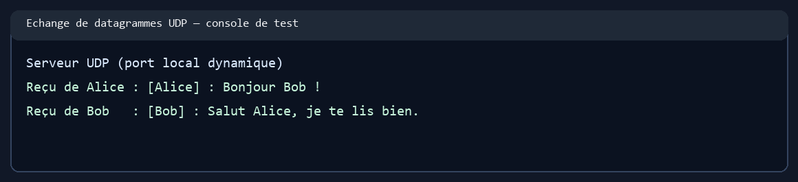
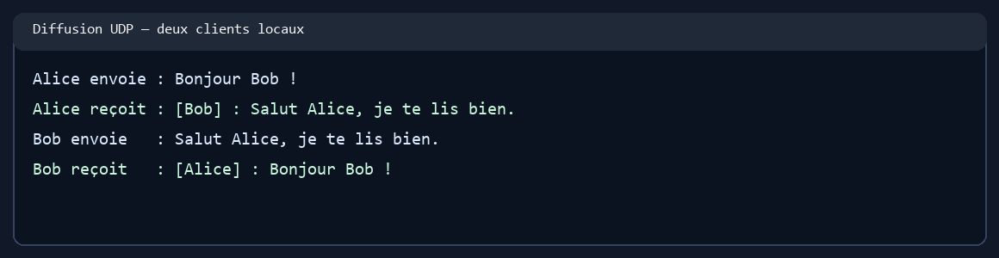

# TP4 — Chat client/serveur avec sockets UDP

Projet Java conforme au TP4 de Développement d'applications réparties (LSI3, FSS, 2026–2027). Il utilise `DatagramSocket`, `DatagramPacket`, `InetSocketAddress` et des datagrammes UTF-8, comme dans le chapitre 1. UDP est non connecté : le serveur associe donc un client à l'adresse IP et au port source observés dans ses datagrammes.

## Contenu

- `ChatServer` écoute sur le port `1234`, affiche l'adresse et le contenu de chaque datagramme, mémorise les clients, puis diffuse le message aux autres clients.
- `ChatClient` demande un nom d'utilisateur, préfixe ses messages avec `[nom] :`, et reçoit les messages dans un thread distinct.
- `/quit` permet au client de signaler son départ. Le serveur reste en fonctionnement.

## Exécution

JDK 8 ou plus récent. Dans IntelliJ, exécuter d'abord `tn.fss.devappreparties.ChatServer`, puis lancer plusieurs instances de `tn.fss.devappreparties.ChatClient`.

Ou depuis la racine du projet :

```bash
mkdir -p out
javac -encoding UTF-8 -d out src/main/java/tn/fss/devappreparties/*.java
java -cp out tn.fss.devappreparties.ChatServer
java -cp out tn.fss.devappreparties.ChatClient localhost 1234
```

Le serveur accepte un port personnalisé (`ChatServer 1234`), et le client accepte un hôte et un port (`ChatClient localhost 1234`). Pour tester entre plusieurs machines, remplacer `localhost` par l'adresse IP du serveur et autoriser UDP sur le port choisi dans le pare-feu.

## Protocole et limites

Chaque message est un datagramme UTF-8. Le serveur conserve l'adresse source après le premier message et n'envoie pas le message à son expéditeur. Le premier message d'un nouveau client sert donc à l'enregistrer et n'est pas renvoyé aux clients déjà présents. Comme l'explique le cours, UDP ne garantit ni livraison, ni ordre, ni absence de doublons ; cette version pédagogique ne met pas en place d'accusé de réception ou de détection de clients inactifs.

## Captures et synthèse

Le protocole a été vérifié par un échange local : Alice et Bob ont envoyé chacun un datagramme, et les deux messages sont bien arrivés à l'autre client. Les copies de la console sont des illustrations de ce résultat.




